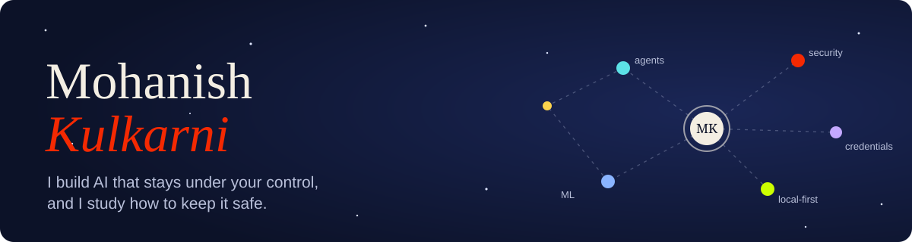
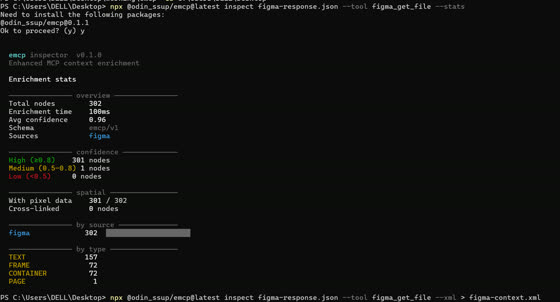
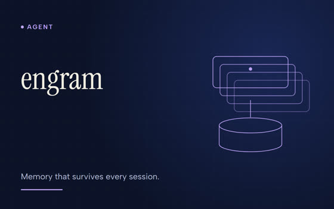
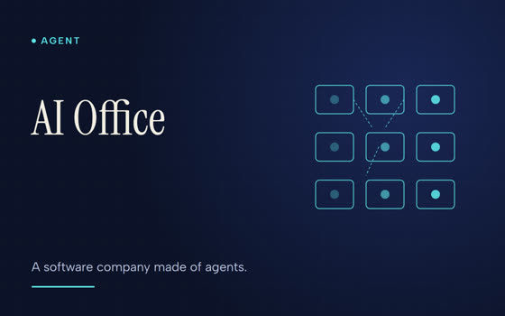
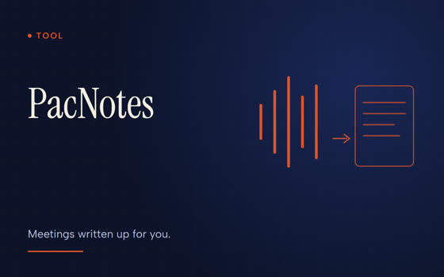
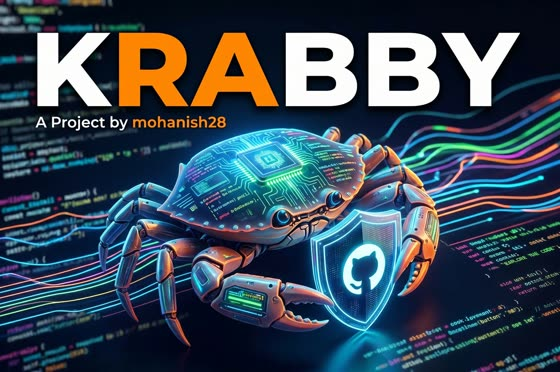
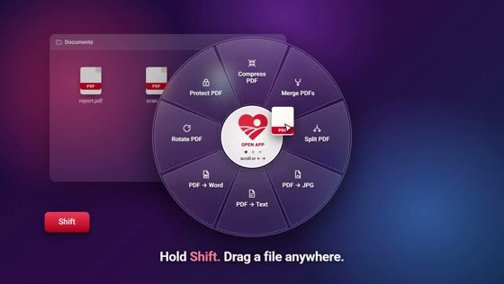

  
  
  
  

---

## About

Final-year Information Technology engineer (SPPU, Pune). I work on LLM agents, local-first tools and AI security. Currently an AI engineer intern building AI agents, LLM applications and workflow automation.

## Research

- **Patent pending:** co-inventor on a provisional application for automated penetration testing and intelligence mapping (filed Dec 2025).
- **Journal:** "AI and ML in Penetration Testing: A Comprehensive Review", IRJET, Vol. 12, Issue 11 (Nov 2025).
- **Conference:** "Penetration Testing for Websites using LLM", ICICVT 2025 (oral presentation).

## Selected projects

| Project | What it does | Stack |
|---|---|---|
| [**eMCP**](https://github.com/mohanish28/emcp) | Published npm middleware that turns raw MCP server responses into typed, confidence-scored context for LLMs. 8 adapters, 117 tests in CI. | TypeScript, MCP |
| [**engram**](https://github.com/mohanish28/engram) | Persistent memory for Claude Code. Decisions, failures and preferences survive across sessions. | Claude Code plugin |
| [**AI Office**](https://github.com/mohanish28/The-office) | A multi-agent software company. PM, CTO, developer, QA and DevOps agents plan, build and deploy an app while you watch a 3D office. | Python, FastAPI, React, Three.js |
| [**PacNotes**](https://github.com/mohanish28/pacnotes) | Windows tray app that transcribes Zoom, Meet and Teams calls locally and emails you the notes as a PDF. | Python, faster-whisper |
| [**Krabby**](https://github.com/mohanish28/Krabby) | Five LLM providers debate and vote to a consensus, with failover and full deliberation traces. | Python, Groq, Ollama |
| [**ILoveLocal**](https://github.com/mohanish28/ILoveLocal) | 47 PDF, image and document tools that run entirely on your PC. | Desktop |
| [**Vidhik Mitra**](https://github.com/mohanish28/Vidhik_Mitra) | RAG legal advisor over 1,000+ constitutional documents. | Python, RAG, Flask |

<table>
<tr>
<td width="33%" align="center"><a href="https://github.com/mohanish28/emcp"> <b>eMCP</b></a></td>
<td width="33%" align="center"><a href="https://github.com/mohanish28/engram"> <b>engram</b></a></td>
<td width="33%" align="center"><a href="https://github.com/mohanish28/The-office"> <b>AI Office</b></a></td>
</tr>
<tr>
<td width="33%" align="center"><a href="https://github.com/mohanish28/pacnotes"> <b>PacNotes</b></a></td>
<td width="33%" align="center"><a href="https://github.com/mohanish28/Krabby"> <b>Krabby</b></a></td>
<td width="33%" align="center"><a href="https://github.com/mohanish28/ILoveLocal"> <b>ILoveLocal</b></a></td>
</tr>
</table>

Short explainer videos for most of these are on the [portfolio](https://www.mohanishkulkarni.in).

## Tools I use

**Focus areas:** LLM agents · RAG · fine-tuning (LoRA) · MCP · local-first AI · AI security

## Get in touch

Open to research conversations, collaborations and internships. The quickest way is [email](mailto:mohanishkul.28@gmail.com).
